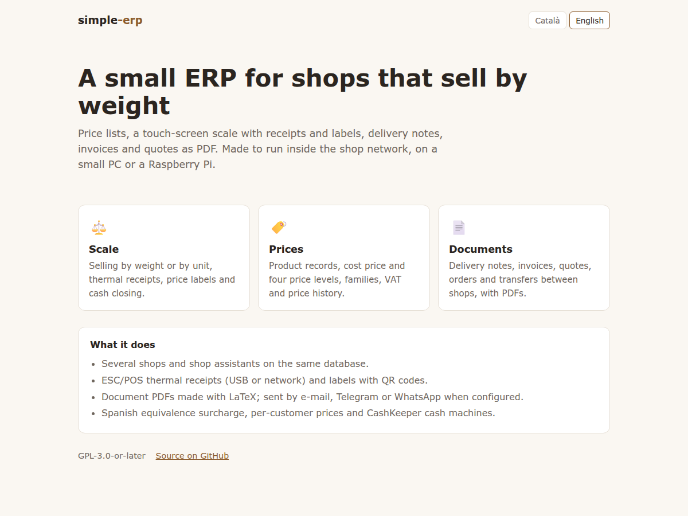
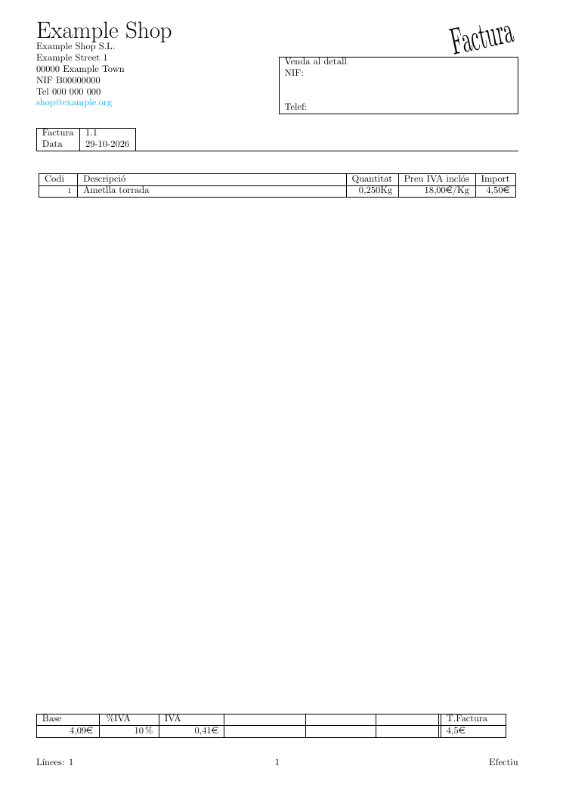

# simple-erp

A small ERP for shops that sell by weight (nuts, dried fruit, spices…): price lists, a
touch-screen scale with thermal receipts and labels, and sales documents (delivery notes,
invoices, quotes, orders, transfers between shops) as PDF. It has been running for years in a
family business with several shops; this is a cleaned-up copy of its code.

*Català més avall.*



## Modules

| Module | What it does |
|---|---|
| `web/scale/` | Touch-screen scale: sell by weight or unit, ESC/POS receipts (USB or network printer), price and product labels with QR code (inkscape), cash closing, staff clock-in, CashKeeper cash machines, card payments from the QR of the bank terminal's digital receipt (Redsys) |
| `web/preus/` | Price management: product records, cost price and four price levels, families, VAT, price history |
| `web/relacions/` | Sales documents: delivery notes, invoices, quotes, orders, inventories, transfers; PDF with LaTeX, links by e-mail, SMS or WhatsApp |
| `web/pdf/` | Public access to the generated PDFs |
| `web/index.html` | Start page |

Background jobs (labels, PDFs, Telegram and e-mail notifications) run in `web/scale/p.php`,
which must be called every few seconds by one machine (the Docker `worker` service or the
`simple-erp-worker` systemd unit do it).

**Card terminal QR (Redsys digital receipt).** When the bank card terminal shows the QR of its
digital receipt, read it with the scale's barcode reader (in the code field, or in the subtotal
screen of a sale). The scale downloads the PDF, reads the amount, reference and masked card
number, stores it in `YYYY_Empresa_N_pdf_tiquettpv` (created automatically, one table per year)
and closes the open invoice or relation-to-assign with the same amount as paid by card (the same
as the card button). If several sales have that amount it asks which one; if none, the receipt
is stored without a sale and can be read again later. The scale receipt prints the reference, the
card number and the QR at the bottom. The confirmation screen (print-receipt and back buttons)
already returns to the scale's main screen on its own after 15 seconds. Needs `pdftotext`
(poppler-utils) and outgoing HTTPS.

## Quick start with Docker

```sh
git clone https://github.com/EduardVidalTulsa/simple-erp.git
cd simple-erp
docker compose up -d
```

Open <http://localhost:8080> and log in as **admin / admin** (change it: users are in the
`users` table; store passwords with PHP `password_hash()`).
The configuration is created on the first start in the `config` volume (`keys.php`): edit it to
set printers, Telegram, e-mail, PDF publishing… Optional variables for `docker compose`:
`DB_PASSWORD`, `SHOP_NAME`, `HTTP_PORT`, `TZ` (default `Europe/Madrid`).

## Install without Docker (Debian/Ubuntu)

```sh
sudo ./install.sh [domain]
```

It installs nginx, PHP-FPM, MariaDB, LaTeX and inkscape, copies everything to
`/srv/simple-erp`, creates the database with the demo data and a random password, and enables the
background worker. The configuration is `/srv/simple-erp/keys.php` (one level above the web
root, never served).

An invoice made from the demo data (LaTeX):



## Configuration

Everything site-specific lives in `keys.php` (see [`keys.example.php`](keys.example.php)):
database, shop name, the address printed on labels, public PDF URL, Telegram, WhatsApp/SMS
commands, SMTP, receipt printer. Per-shop settings (receipt header, label and A4 printers,
CashKeeper address…) are in the `Empresa` table.

The database structure is in [`db/schema.sql`](db/schema.sql) and the demo data in
[`db/demo.sql`](db/demo.sql). The per-year and per-shop tables (`2026_Empresa_1_line`,
`…_index_relacio`, `…_pdf`) are created automatically.

## Status and warnings

This is old, pragmatic PHP that grew with the business, not a framework. Comments and the user
interface are mostly in Catalan. It is meant for a **trusted shop network**: do not expose it to
the Internet as is (SQL is built by hand in many places). Old databases with plain-text passwords
keep working; new users should get hashed ones.

Related projects: [hiopos-virtual-printer](https://github.com/EduardVidalTulsa/hiopos-virtual-printer),
[hiopos-cashkeeper-bridge](https://github.com/EduardVidalTulsa/hiopos-cashkeeper-bridge).

---

## Català

Un ERP petit per a botigues que venen a pes (fruits secs, fruita seca, espècies…): tarifes,
bàscula tàctil amb tiquets tèrmics i etiquetes, i documents de venda (albarans, factures,
pressupostos, comandes, traspassos entre botigues) en PDF. Fa anys que funciona en un negoci
familiar amb diverses botigues; això n'és una còpia neta del codi.

**Posar-lo en marxa amb Docker:** `docker compose up -d`, obriu <http://localhost:8080> i
entreu amb **admin / admin** (canvieu-la). La configuració (`keys.php`) es crea el primer cop al
volum `config`.

**Sense Docker (Debian/Ubuntu):** `sudo ./install.sh [domini]` ho instal·la tot a
`/srv/simple-erp`, amb la base de dades, les dades d'exemple i el procés de fons.

**Mòduls:** `scale` (bàscula, tiquets, etiquetes, tancament de caixa, fitxatge, CashKeeper),
`preus` (fitxes, tarifes, famílies, IVA, historial), `relacions` (albarans, factures,
pressupostos… amb PDF) i `pdf`. Les feines de fons les fa `scale/p.php`, que una sola màquina ha
de cridar cada pocs segons.

**QR del TPV (tiquet digital de Redsys):** si es llegeix amb el lector de la bàscula el QR que
mostra el TPV del banc, la bàscula baixa el PDF, en treu l'import, la referència i la targeta, el
desa a `ANY_Empresa_N_pdf_tiquettpv` (es crea sola, una per any) i tanca com a cobrada amb targeta
la factura o relation_to_assing oberta amb el mateix import. Si n'hi ha més d'una, pregunta quina;
si no n'hi ha cap, el desa sense venda. Al peu del tiquet s'imprimeix la referència, la targeta i
el QR. La pantalla de confirmació (botons d'imprimir i tornar) ja torna sola a la pantalla
principal de la bàscula al cap de 15 segons. Cal `pdftotext` (poppler-utils) i sortida HTTPS.

**Avís:** és codi PHP antic i pràctic, pensat per a la xarxa de la botiga. No el publiqueu a
Internet tal com és.

## License / Llicència

GPL-3.0-or-later. See [LICENSE](LICENSE).
