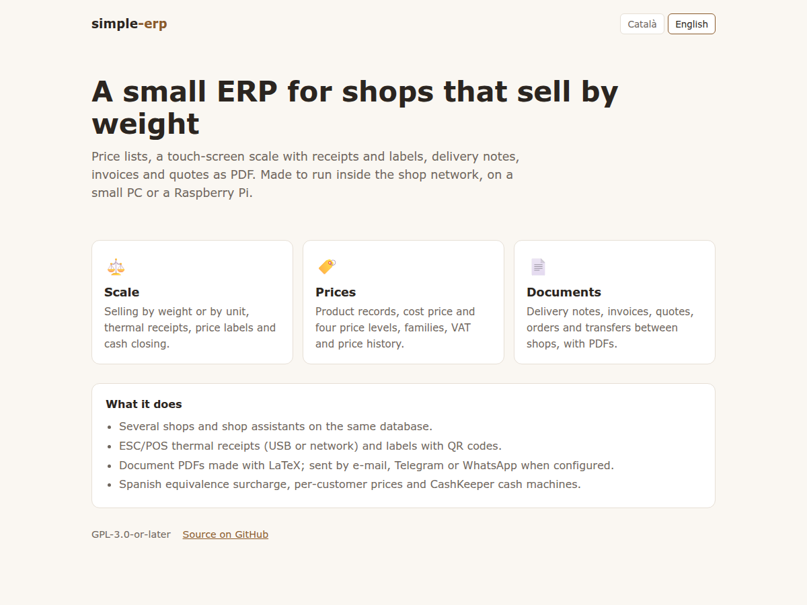
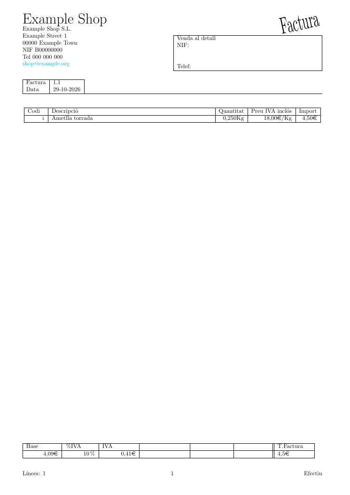

# simple-erp

A small ERP for shops that sell by weight (nuts, dried fruit, spices…): price lists, a
touch-screen scale with thermal receipts and labels, and sales documents (delivery notes,
invoices, quotes, orders, transfers between shops) as PDF. It has been running for years in a
family business with several shops; this is a cleaned-up copy of its code.

*Català més avall.*



## Modules

| Module | What it does |
|---|---|
| `web/scale/` | Touch-screen scale: sell by weight or unit, ESC/POS receipts (USB or network printer), price and product labels with QR code (inkscape), cash closing, staff clock-in, CashKeeper cash machines, card payments from the QR of the bank terminal's digital receipt (Redsys) |
| `web/preus/` | Price management: product records, cost price and four price levels, families, VAT, price history |
| `web/relacions/` | Sales documents: delivery notes, invoices, quotes, orders, inventories, transfers; PDF with LaTeX, links by e-mail, SMS or WhatsApp |
| `web/makevoucher/` | Gift/discount vouchers: create a voucher with a one-time QR code, print it on the receipt printer, redeem it at the scale's subtotal screen (capped to what's left to pay; the rest is paid as usual). Only on the central site when there are several (see below) |
| `web/altaclient/`, `web/condicions/` | Public new-client sign-up: the client accepts the terms (`/condicions`, versioned in the `Condicions` table) and confirms each e-mail address by a link before the client is created; a proof-of-work challenge replaces the captcha, unconfirmed requests are deleted after 48 h (`php web/altaclient/neteja.php` hourly) and every step is logged in `Clients_consentiment`. Logged-in staff see and edit the client list instead |
| `web/client/` | Client area: clients sign in with their verified e-mail (a one-time link or 6-digit code, no password) and see their invoices, delivery notes and receipts of the last five years with net amount, VAT per rate and total, plus a yearly summary (invoices, receipts and delivery notes not yet invoiced) for the Spanish 347 return; they can also edit their details (all but the VAT id), phones and extra e-mails, or unsubscribe. Runs on the server with `$ALTCHA_KEY` |
| `web/plugins/`, `web/admin/` | Plugins (door switch, queue tickets, vouchers) that are turned on and configured at `/admin` (see below) |
| `web/pdf/` | Public access to the generated PDFs |
| `web/index.php` | Start page: public links to staff sign-in, the client area and client sign-up; once signed in, links to the scale, prices and sales documents |
| `hardware/` | Shell scripts that read a physical serial-port scale and feed its weight into the `ultimpes` table that `web/scale/` polls; adapt the serial protocol to your own scale model |

Receipts are e-mailed only to the client's verified addresses (main one plus the copies in `Clients_email`),
each with a signed unsubscribe link (`altaclient/baixa.php`, needs `$pdf_token_secret` and the central's
`Empresa.url_seu` or `$altaclient_url`).
Background jobs (labels, PDFs, Telegram and e-mail notifications) run in `web/scale/p.php`,
which must be called every few seconds by one machine (the Docker `worker` service or the
`simple-erp-worker` systemd unit do it).

**Card terminal QR (Redsys digital receipt).** When the bank card terminal shows the QR of its
digital receipt, read it with the scale's barcode reader (in the code field, or in the subtotal
screen of a sale). The scale downloads the PDF, reads the amount, reference and masked card
number, stores it in `YYYY_Empresa_N_pdf_tiquettpv` (created automatically, one table per year)
and closes the open invoice or relation-to-assign with the same amount as paid by card (the same
as the card button). If several sales have that amount it asks which one; if none, the receipt
is stored without a sale and can be read again later. The scale receipt prints the reference, the
card number and the QR at the bottom. The confirmation screen (print-receipt and back buttons)
already returns to the scale's main screen on its own after 15 seconds. Needs `pdftotext`
(poppler-utils) and outgoing HTTPS.

**Gift/discount vouchers.** `web/makevoucher/` creates a voucher for one `Empresa` (shop), with a
random, single-use code printed as a QR plus a human-readable code. Reading that code at the
scale's subtotal screen applies it: `min(voucher amount, what's left to pay)`, closing the sale if
that covers it, or leaving it open to pay the rest as usual if it doesn't. If you run **one shop
per server** (each with its own database) rather than one shared database for all shops, mark the
`Empresa` row of the main one with `seu_central=1` and `url_seu`: `web/makevoucher/` then redirects
there from any other shop, so vouchers are always created in one place. `Empresa.host_ssh` (empty
by default) makes printing happen over SSH on that shop's own machine instead of the one running
`makevoucher`, for that same one-server-per-shop setup — it assumes the same install path on both
ends and a passwordless SSH key for the web server user, which is worth thinking about before
turning it on. Vouchers are redeemed against the shop's own `Empresa_N_voucher` table, so in that
setup you need to copy that table from the central site to each shop (and send redeemed vouchers
back); this repository does not include that sync.

**Plugins.** Optional features live in `web/plugins/<name>/`, each described by a `plugin.json`
(title, description, scope, default state and settings). Users with `users.pot_gestionar_plugins=1`
(the demo `admin`) turn them on and off and configure them at **`/admin`**. A plugin's scope is
either the whole server (`lloc`) or one scale user (`usuari`): user plugins can draw a small widget
at the bottom right of the scale screen and handle codes typed in the scale's code field. Settings
are stored in the `plugin` and `plugin_usuari` tables (created automatically). Included plugins:

| Plugin | What it does |
|---|---|
| `porta` (per user) | Floating switch on the scale to lock/unlock a door through a Shelly Gen2+ relay on the local network (relay on = unlocked). Setting: the Shelly's address, e.g. `192.0.2.6` |
| `torn` (per user) | Queue tickets for a busy counter. An old phone or tablet in kiosk mode opens `/plugins/torn/client.php?token=…` (the link is shown at `/admin`): customers tap *Agafa torn* and the scale's receipt printer prints "Torn K – M people ahead"; the page shows how many people are waiting and keeps the screen on (Wake Lock, needs HTTPS). On the scale, staff see the current number and move it with + and −, or by typing `++` (next) and `+-` (back) in the code field. Under the button a QR code (it changes every day) lets customers take a number on their own phone without paper; their page shows when they took it and how many people are ahead, refreshing every 10 s. An ON/OFF button on the scale's widget stops handing out numbers: the kiosk then shows a QR code to the client sign-up. Numbers restart every day and go from 1 to 999; the counter is stored in `Empresa_<ID>_torn`. Settings: public address for the QR (if the kiosk opens the server by a LAN address) and sign-up address |
| `voucher` (whole server, on by default) | The gift/discount vouchers above. Turning it off disables `/makevoucher` and voucher redemption at the scale. Settings: default expiry in days and the thank-you text printed on the voucher |

## Quick start with Docker

```sh
git clone https://github.com/EduardVidalTulsa/simple-erp.git
cd simple-erp
docker compose up -d
```

Open <http://localhost:8080> and log in as **admin / admin** (change it: users are in the
`users` table; store passwords with PHP `password_hash()`).
The configuration is created on the first start in the `config` volume (`keys.php`): edit it to
set printers, Telegram, e-mail, PDF publishing… Optional variables for `docker compose`:
`DB_PASSWORD`, `SHOP_NAME`, `HTTP_PORT`, `TZ` (default `Europe/Madrid`).

## Install without Docker (Debian/Ubuntu)

```sh
sudo ./install.sh [domain]
```

It installs nginx, PHP-FPM, MariaDB, LaTeX and inkscape, copies everything to
`/srv/simple-erp`, creates the database with the demo data and a random password, and enables the
background worker. The configuration is `/srv/simple-erp/keys.php` (one level above the web
root, never served).

An invoice made from the demo data (LaTeX):



## Configuration

Everything site-specific lives in `keys.php` (see [`keys.example.php`](keys.example.php)):
database, shop name, the address printed on labels, public PDF URL, Telegram, WhatsApp/SMS
commands, SMTP, receipt printer. Per-shop settings (receipt header, label and A4 printers,
CashKeeper address…) are in the `Empresa` table.

The database structure is in [`db/schema.sql`](db/schema.sql) and the demo data in
[`db/demo.sql`](db/demo.sql). The per-year and per-shop tables (`2026_Empresa_1_line`,
`…_index_relacio`, `…_pdf`) are created automatically.

## Status and warnings

This is old, pragmatic PHP that grew with the business, not a framework. Comments and the user
interface are mostly in Catalan. It is meant for a **trusted shop network**: do not expose it to
the Internet as is (SQL is built by hand in many places). Old databases with plain-text passwords
keep working; new users should get hashed ones.

Related projects: [hiopos-virtual-printer](https://github.com/EduardVidalTulsa/hiopos-virtual-printer),
[hiopos-cashkeeper-bridge](https://github.com/EduardVidalTulsa/hiopos-cashkeeper-bridge).

---

## Català

Un ERP petit per a botigues que venen a pes (fruits secs, fruita seca, espècies…): tarifes,
bàscula tàctil amb tiquets tèrmics i etiquetes, i documents de venda (albarans, factures,
pressupostos, comandes, traspassos entre botigues) en PDF. Fa anys que funciona en un negoci
familiar amb diverses botigues; això n'és una còpia neta del codi.

**Posar-lo en marxa amb Docker:** `docker compose up -d`, obriu <http://localhost:8080> i
entreu amb **admin / admin** (canvieu-la). La configuració (`keys.php`) es crea el primer cop al
volum `config`.

**Sense Docker (Debian/Ubuntu):** `sudo ./install.sh [domini]` ho instal·la tot a
`/srv/simple-erp`, amb la base de dades, les dades d'exemple i el procés de fons.

**Mòduls:** `scale` (bàscula, tiquets, etiquetes, tancament de caixa, fitxatge, CashKeeper),
`preus` (fitxes, tarifes, famílies, IVA, historial), `relacions` (albarans, factures,
pressupostos… amb PDF), `makevoucher` (xecs regal/descompte amb QR d'un sol ús) i `altaclient`
(alta pública de clients: accepta les condicions de `/condicions` i confirma cada correu per un enllaç;
les sol·licituds sense confirmar s'esborren a les 48 h amb `php web/altaclient/neteja.php` cada hora).
Els tiquets només s'envien per correu a adreces verificades i porten un enllaç de baixa.
A `/client/` els clients entren amb el correu (enllaç o codi d'un sol ús, sense contrasenya) i hi veuen les
factures, albarans i tiquets dels últims cinc anys amb base, IVA i total, i un resum anual per al model 347;
hi poden canviar les seves dades (menys el NIF), telèfons i correus, o donar-se de baixa. Les feines de fons les fa `scale/p.php`, que una sola
màquina ha de cridar cada pocs segons. A `hardware/` hi ha els scripts que llegeixen una bàscula
física per port sèrie i n'alimenten el pes a la taula `ultimpes`.

**Connectors:** les funcions opcionals són a `web/plugins/<nom>/` (cadascuna amb el seu
`plugin.json`) i s'activen i es configuren a **`/admin`** (cal `users.pot_gestionar_plugins=1`).
N'hi ha de tot el servidor i d'usuari de bàscula. Inclosos: `porta` (interruptor flotant a la
bàscula per bloquejar una porta amb un Shelly Gen2+), `torn` (torns per a una parada amb cua: un
mòbil vell en mode quiosc fa de botó per als clients i imprimeix «Torn K, teniu davant M
persones»; a la bàscula es passa de torn amb + i − o teclejant `++` i `+-`; cada dia torna a
començar, de 1 a 999; un QR diari deixa agafar torn des del mòbil del client sense paper, i amb el
botó ON/OFF del giny s'aturen els torns i el quiosc mostra el QR d'alta de client) i `voucher` (els xecs regal; desactivat, no se'n poden crear ni cobrar).
Amb un servidor per seu, els xecs es creen a la central i cal portar la taula `Empresa_N_voucher`
a cada seu (i retornar-ne els cobrats) amb la vostra pròpia sincronització.

**QR del TPV (tiquet digital de Redsys):** si es llegeix amb el lector de la bàscula el QR que
mostra el TPV del banc, la bàscula baixa el PDF, en treu l'import, la referència i la targeta, el
desa a `ANY_Empresa_N_pdf_tiquettpv` (es crea sola, una per any) i tanca com a cobrada amb targeta
la factura o relation_to_assing oberta amb el mateix import. Si n'hi ha més d'una, pregunta quina;
si no n'hi ha cap, el desa sense venda. Al peu del tiquet s'imprimeix la referència, la targeta i
el QR. La pantalla de confirmació (botons d'imprimir i tornar) ja torna sola a la pantalla
principal de la bàscula al cap de 15 segons. Cal `pdftotext` (poppler-utils) i sortida HTTPS.

**Avís:** és codi PHP antic i pràctic, pensat per a la xarxa de la botiga. No el publiqueu a
Internet tal com és.

## License / Llicència

GPL-3.0-or-later. See [LICENSE](LICENSE).
